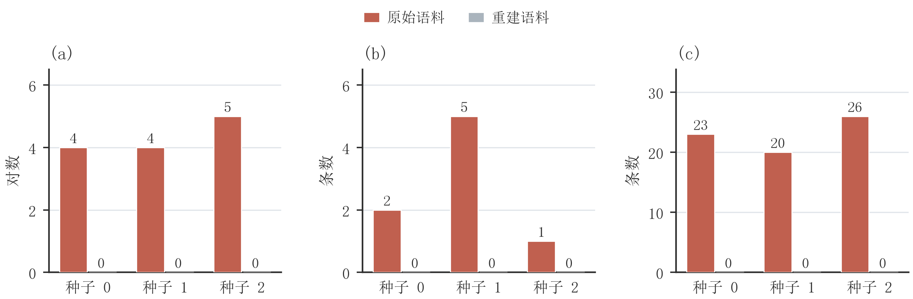
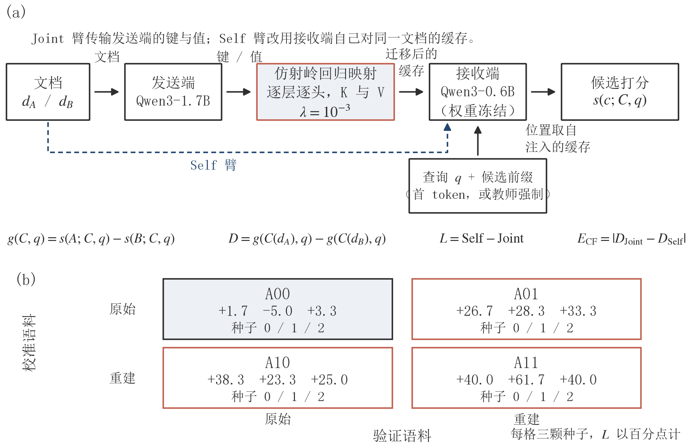
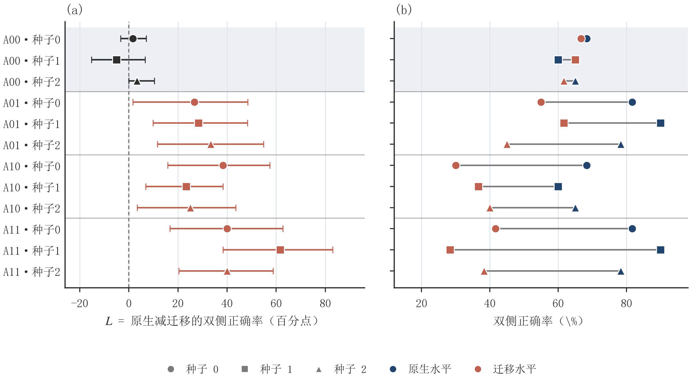
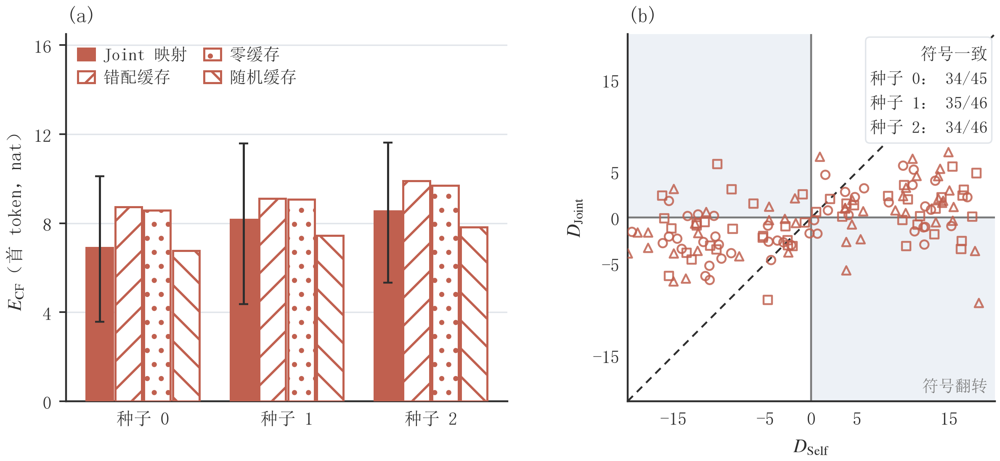
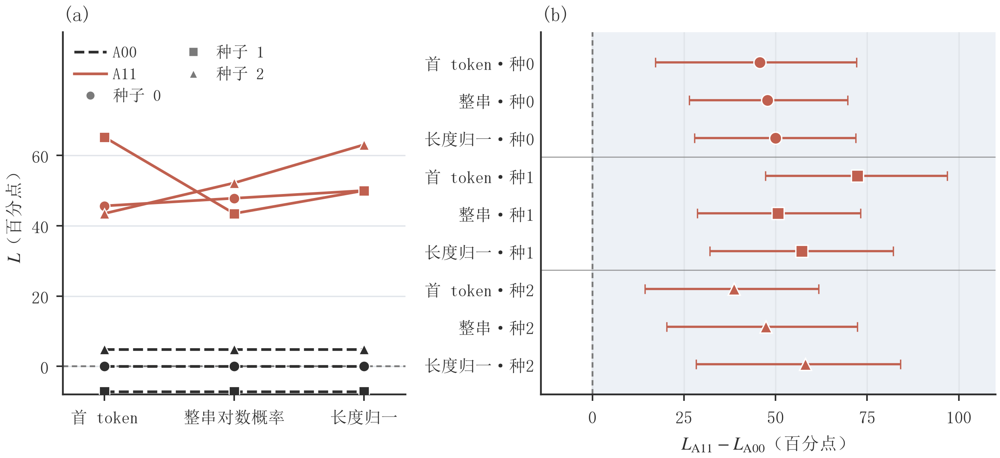
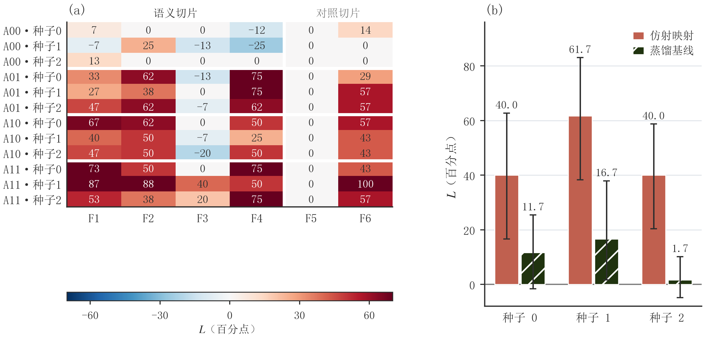

# 重建基准如何反转结论

## 跨模型 KV 缓存迁移的一次数据审计与复算

> 本文是 `main.tex` 的白话版。章节顺序、数字、公式、表格和引用与正式稿完全一致，只把费解的学术措辞换成自然中文。正式投稿仍以 `main.tex` 为准。

---

## 读正文前先看：几个词到底是什么意思

正式稿里的不少词容易让人误解，这里先把它们说成人话，后文就不再逐个解释。

| 正式稿里的词 | 大白话意思 |
|---|---|
| KV 缓存 | 模型读完文档后留在"脑子里"的笔记，分"键"（用来检索的索引）和"值"（具体内容） |
| 预填（prefill） | 把文档从头到尾读一遍、整理成笔记的过程 |
| KV 缓存迁移 | 把模型 A 做好的笔记直接交给模型 B 用，B 就不用再读一遍文档 |
| 发送端 / 接收端 | 做笔记的模型 A / 拿笔记来用的模型 B |
| 仿射映射 | 用一个"先乘一个数、再加一个数"的简单公式，把 A 的笔记翻译成 B 能用的格式 |
| 岭回归、λ | 一种简单的拟合方法；λ 是防止把训练数据背得太死的调节旋钮 |
| 校准集 / 验证集 | 用来"调翻译公式"的数据 / 用来"考试"的数据 |
| 反事实 | 把文档里的事实改掉，看模型的打分会不会跟着变 |
| 候选、配对文档 | 两个备选答案；两篇只有关键事实不同的文档 |
| 双侧正确率 | 在两篇文档下都判断对的题目所占比例 |
| Self / Joint | 原生：接收端自己读文档作答；迁移：接收端拿着传来的笔记作答 |
| L | 原生正确率减去迁移正确率，单位是百分点；数越大，说明迁移丢得越多 |
| 首 token / 整串打分 | 只看答案第一个词 / 把答案整句话都算进去的打分方式 |
| 模板族 | 按题目模板分的组；重采样时整组一起抽，避免把相关题目当成彼此独立的题目 |
| 区间、探索性区间 | 结果的不确定性范围；这里的区间只供参考，不当作正式显著性结论 |
| 退化配对 | 题目要求答案翻转，但两个候选其实一模一样 |
| 泄漏、逐字重叠 | 调参数据和考试数据里出现相同文档，会让成绩虚高 |
| F1–F4 / F5、F6 | 四种真考理解的题型 / 两种对照题型，不参与方向一致性统计 |
| 错配、置零、随机缓存 | 故意给错笔记、清空笔记、乱填笔记，用来量一量"传来的笔记到底有没有用" |

---

## 摘要

跨模型的 KV 缓存迁移，目标是让接收端模型不用重新读一遍文档，就能回答关于这篇文档的问题。我们此前在一套自己造的配对文档基准上，得到了一个偏乐观的结论：仿射映射看起来既保住了答题正确率，又改变了"改事实后打分怎么变"的反事实表现。

重新算这套基准时，我们发现了三类问题：有些题目要求答案必须翻转，可两个候选文本却一模一样；校准数据和验证数据里有逐字重复的文档；区间估计把本该归为一组的相关样本当成了独立样本。

本文不动模型，只改数据和统计口径，把所有单元重做了一遍：把原始版和重建版的校准语料、验证语料两两交叉，在 Qwen3-1.7B→0.6B 这一对模型上得到 4 个单元 × 3 颗种子。用"原生减迁移"的双侧正确率差 L 来衡量：在"原始/原始"这一格，L 是 −5.0 到 3.3 个百分点；在另外九个包含重建数据的单元里，L 是 23.3 到 61.7 个百分点。换句话说，仅仅重建一次基准，就把"几乎无损"翻成了"明显有损"。

接着我们用完整候选序列重新打分了两个对角单元：三颗种子的方向一致，但其中一颗的差距比只看首个词时收窄了 21.7 个百分点。

结论的适用范围很清楚：只是一对模型、一套合成中文语料、一个仿射映射器。L 同时受语料版本和打分口径影响；上一轮关于"接收端究竟怎么使用传来的值"的机制性说法，我们不再保留。对做基准的人，最低要求是先同时报告原生和迁移的正确率，并且在解读反事实差距之前，先检查配对、切分和打分规则。

**关键词**：KV 缓存迁移；基准审计；数据泄漏；打分口径；探索性区间

---

## 1 引言

缓存翻译的想法很直接：一篇文档已经被某个模型读过了、笔记也做好了，能不能把这份笔记直接给另一个模型用，省掉再读一遍的时间？衡量"复用得好不好"有两把尺子。一把是端到端的正确率——传过去的笔记能不能让接收端答对题；另一把是配对反事实——把文档里的事实改一改，候选的打分会不会跟着变。这两把尺子可能给出相反的信号：笔记在正确率上看着没损失，反事实打分却大幅偏移。要诊断这种偏移，前提是文档对本身是干净的，而且接收端在两种文档下都能正常作答。

我们此前报告过这样一个诊断：仿射映射在保住双侧正确率的同时，改变了反事实打分，我们还据此猜过一个关于接收端如何消费这些值的机制。复算时发现，这套基准和统计口径都有毛病，那两条论断我们都撤回了。重建语料之后，同一个对角线比较从"差距接近零"变成了"差二三十到六七十个百分点"。所以本文只问两个更窄的问题：

1. 这个反转到底是校准语料造成的、验证语料造成的，还是两者一起造成的？
2. 把"只看候选第一个词"换成"看完整候选序列"，结论还站得住吗？

第一个问题用"校准 × 验证"的 2×2 交叉来回答：四个单元各自使用原始或重建的两套语料，同一颗种子只换其中一套。第二个问题用"教师强制"下整段候选的条件对数概率之和来回答，只覆盖两个对角单元。这两个问题都不需要新模型、新数据或更强的算力，只要把已有的归档记录按统一口径重算一遍——这也正是本文想示范的做法。

**相关工作。** Heo 等人给出了逐层的闭式线性映射，并报告在某些模型对上退化明显；KV-Lingo 用蒸馏的方式训练 KV 翻译器；CacheLink 区分了"重建得像不像"和"接收端能不能用"两件事；Cheng 等人用错配、置零和随机缓存来检验示例特定信息的作用。我们的对照设计和后者同源，但关心的是一个可复现的"基准版本反转"。最小改动输入的思路来自对比集评估；数据审计针对的泄漏和相关评估单元问题见 Kapoor 与 Narayanan 的工作。本文的增量在于"校准 × 验证"的交叉比较，以及随后对打分口径的复核。

---

## 2 基准与审计

**配对文档任务。** 每个样例包含一个问题、两篇分别构造的文档、两个候选答案。四个语义切片要求"改动必须让正确答案翻转"：直接换事实（F1）、改推理链（F2）、改关系或否定（F3）、加干扰项和共指（F4）。F5 的两个候选文本完全一样，当作"不该翻转"的对照；F6 只改人名和对应的答案标签，同时控制长度和位置。F5、F6 在方向一致性统计里一律排除。

**重建到底改了什么。** 归档的 seed-0 语料共 520 对（校准 120、验证 60、探针 40、测试 300）。审计发现三类问题：18 个"必须翻转却候选相同"的退化配对；至少 15 组跨切分逐字重复的文档；校准集和留出集共用实体和模板骨架；而且历史上的重采样单元，实质上就等于单个配对。重建时，我们让候选在需要翻转的地方真的不一样，把实体池按切分隔开，去掉重复，并在探针集和留出集里引入结构上没见过的模板。

单看本文用的验证集：每个版本、每颗种子有 46 对落在 F1–F4；原始验证集的退化配对数分别是 4、4、5，校准与验证之间逐字相同的文档串是 2、5、1；重建之后这两类数字都变成了零。重建语料里 F1–F4 共有 398 个样例（这是全语料的计数）。图 2 把这三个缺陷在重建前后的数量对照画了出来。

*图 2：重建前后验证集上的缺陷数量（用随包语料文件重新算出来的）。(a) F1–F4 里两个候选完全一样、却被要求翻转的配对；(b) 校准集和验证集之间逐字相同的文档串；(c) 两套切分之间重复的查询串。重建语料里这三种缺陷都是零；每个面板的纵轴刻度各自独立。*

**一句提醒。** 我们把语料版本当成"整包"来比较：一次替换同时改了候选、实体池、模板和去重状态。所以本文只能说"换成这一包语料之后，结果变了"，不能说"变化是其中某一个缺陷造成的"。校准集影响的是映射本身，验证集影响的是被考的任务和原生参照，两者在原理上可以分开，这才有了下面的 2×2 交叉。

---

## 3 评估

**模型、映射和两种缓存条件。** 发送端是 Qwen3-1.7B，接收端是 Qwen3-0.6B，都是 28 层，一层对一层；接收端的权重全程冻结。仿射映射对每一层、每个注意力头、K 和 V 分别拟合岭回归，用 120 对校准样本的配对缓存来训练，λ=10⁻³，闭式求解，算上截距大约 7.40×10⁶ 个系数。归档里的 GPU 运行用的是 bfloat16 和 SDPA。

*Self*（原生）条件：接收端用自己对同一篇文档的原生缓存。*Joint*（迁移）条件：把发送端的键和值都映射后注入接收端。接收端只看到查询，以及整串打分时才有的候选前缀；文档的位置信息来自注入的缓存。我们还做了恒等注入检查，用来确认接收端的缓存通路没问题：在 80 个文档侧上，原生缓存和恒等注入一致，报告的最小余弦值四舍五入为 1.0，首 token 的 KL 为零。另外有三种对照缓存——错配（在同一验证集内确定性地换成"下一个样例"）、置零、随机——用来给"迁移误差"一个量级参照。错配对照沿用了上述实验里的取值，因为历史上的错配选法不同。图 1 画出了这条路径和四个单元。

*图 1：笔记是怎么传的、语料版本怎么交叉。(a) 发送端逐层的键和值，经过逐层逐头的仿射岭回归映射后，注入冻结的接收端；接收端只看查询和候选前缀。Self 这一臂改用接收端自己对同一篇文档的缓存。(b) 原始（0）和重建（1）的校准、验证语料交叉，每格三颗种子，格里标的是三颗种子的 L（百分点），历史对角格加了灰底。g、D、L、E_CF 的定义见第 3 节。*

**两种候选打分。** 记 s(c;C,q) 为候选 c 在查询 q、缓存 C 下的得分。"首 token"口径取候选第一个 token 的下一个 token 对数概率；复核口径取教师强制下全部候选 token 的条件对数概率之和，另外再做一次长度归一。候选都从各自独立初始化的接收端缓存分支出发，查询和候选分别分词后拼接，不加 EOS。两种口径都按候选在两篇文档下分别排序；打平时沿用历史规则（先到者胜）；"两个候选都判对"时，这一对记为正确。用这套规则在 CPU 上回放，720 条首 token 双侧标签全部和归档一致。需要说明：在统一口径之前，序列评分入口在 F5 上认不出"任一候选即可"的金标签，造成 84 条标签不同；在语义样本上把同分判给第二个候选，造成 6 条标签不同；统一口径之后，这些差异都消失了。

**指标。** 分别报告 Self 和 Joint 的"两篇文档都答对"的比例，记 L 为两者之差（百分点）：

$$
g(C,q) = s(A;C,q) - s(B;C,q),
$$

$$
D = g(C(d_A),q) - g(C(d_B),q),
$$

$$
E_{\mathrm{CF}} = \left| D_{\mathrm{Joint}} - D_{\mathrm{Self}} \right|.
$$

其中 E_CF 是 Joint 相对 Self 的反事实偏差；按定义，Self 相对自身为零。不同打分口径给出的误差尺度不一样，所以误差只在同一种口径内比较，跨口径只比较正确率。方向一致性统计的是 F1–F4 里满足 |D_Self| > 0.1 的配对中，Joint 与 Self 的 D 同号的比例，并同时给出分子和分母。

**设计与区间。** 校准集合取 {原始, 重建}，验证集合取 {原始, 重建}，交叉成四个单元：A00 是"原始/原始"（历史配置），A01 换验证集，A10 换校准集，A11 两者都换。每个单元三颗独立的数据种子，每格 60 对验证样本。固定验证集的比较按样本配对；跨验证集的比较对两套样本各自独立重采样。区间由模板族（每个版本 8 族，语义子集 6 族）重采样 10000 次得到，区间宽度按样本加权的口径算；族等权的点估计和区间作为敏感性分析另附。所有区间都是探索性的 95% 百分位区间，种子一颗一颗单独报告，不取平均。语料版本的设计在正式运行前就定稿了；整串打分的方案在可复现重跑之前已经提交到版本库，它之前的工程性试跑仍留在档案里，但不用来估计主效应。

---

## 4 结果

### 4.1 换校准集、换验证集，都会改变结论

**表 1：语料版本比较。** 每个单元、每颗种子 60 对验证样本。Self 与 Joint 是双侧正确率（%），L 及其模板族区间以百分点计。

| 单元 | 种子 | Self | Joint | L [95% 区间] |
|---|---|---|---|---|
| A00 | 0 | 68.3 | 66.7 | 1.7 [−3.3, 7.0] |
| A00 | 1 | 60.0 | 65.0 | −5.0 [−15.3, 6.7] |
| A00 | 2 | 65.0 | 61.7 | 3.3 [0.0, 10.3] |
| A01 | 0 | 81.7 | 55.0 | 26.7 [1.7, 48.4] |
| A01 | 1 | 90.0 | 61.7 | 28.3 [9.8, 48.3] |
| A01 | 2 | 78.3 | 45.0 | 33.3 [11.7, 54.8] |
| A10 | 0 | 68.3 | 30.0 | 38.3 [15.8, 57.4] |
| A10 | 1 | 60.0 | 36.7 | 23.3 [6.9, 38.3] |
| A10 | 2 | 65.0 | 40.0 | 25.0 [3.4, 43.5] |
| A11 | 0 | 81.7 | 41.7 | 40.0 [16.7, 62.7] |
| A11 | 1 | 90.0 | 28.3 | 61.7 [38.3, 83.1] |
| A11 | 2 | 78.3 | 38.3 | 40.0 [20.3, 58.7] |

*图 3：语料版本的结果。(a) 每个单元、每颗种子的 L 及其模板族区间，历史对角格 A00 用灰底标出，虚线是零差距参考线。(b) 造成这个差距的两个正确率水平：左端是迁移，右端是原生，只有同一行里比较才成立。*

表 1 和图 3 是同一批数字的两种看法。历史对角格 A00 的三颗种子分别是 1.7、−5.0、3.3 个百分点，区间都和零重叠；其余九个单元落在 23.3 到 61.7 个百分点之间，区间基本离开零。固定验证集、只换校准集时，L 分别上升 36.7、28.3、21.7 个百分点（验证集为原始版）；换成重建验证集后，对应上升 13.3、33.3、6.7。

换验证集也会移动参照。以种子 0、校准集为重建版为例：Joint 从 30.0% 升到 41.7%，Self 同时从 68.3% 升到 81.7%，于是差距反而扩大了 1.7 个百分点——迁移确实变好了，但原生参照升得更快。两个固定验证集的校准对比之差（也就是交互项）在三颗种子上分别是 −23.3、5.0、−15.0 个百分点，探索性区间都盖住零；也就是说，我们能确认"每一处切换都改变了结论"，但不能确认交互的方向。把分析限制在语义切片，或者剔除候选相同的对照样本，A00 和其余单元的对比关系不变。

**迁移缓存的误差和对照。** 在"重建/重建"这一格上，Joint 的首 token 反事实偏差是 6.90 到 8.54，三颗种子都低于错配和置零对照的均值，而双侧正确率同时掉到 28.3%–41.7%。语义切片上的方向一致率是 34/45、35/46、34/46。这两件事并不矛盾：误差比对照小，说明映射确实带进了和具体样例有关的信息；正确率大幅下降，说明这些信息还不足以支撑作答。图 5 把误差、三种对照和逐配对的符号关系画在了一起。

*图 5：反事实误差和几种对照缓存。(a) 仿射映射的首 token E_CF，与错配、置零、随机三种对照缓存的均值对比；误差棒是 Joint 这一臂的模板族区间。(b) 语义切片上逐配对的 D_Self 和 D_Joint；靠近对角线的点表示两侧同号，左上和右下是符号翻转区，|D| > 20 nat 的点不画出来，内嵌小图是每个种子的"同号 / 可评估"。*

### 4.2 整串打分保住了方向，但幅度会动

**表 2：打分复核（语义子集，候选相异且金标签互换）。**"原生 / 迁移"是 Self/Joint 的双侧正确率（%）；末三列是 L（百分点）。

| 单元 | 种子 | 对数 | 首 token：原生/迁移 | 整串：原生/迁移 | L 首 token | L 整串 | L 长度归一 |
|---|---|---|---|---|---|---|---|
| A00 | 0 | 42 | 64.3 / 64.3 | 64.3 / 64.3 | 0.0 | 0.0 | 0.0 |
| A00 | 1 | 42 | 52.4 / 59.5 | 52.4 / 59.5 | −7.1 | −7.1 | −7.1 |
| A00 | 2 | 41 | 61.0 / 56.1 | 61.0 / 56.1 | 4.9 | 4.9 | 4.9 |
| A11 | 0 | 46 | 76.1 / 30.4 | 80.4 / 32.6 | 45.7 | 47.8 | 50.0 |
| A11 | 1 | 46 | 87.0 / 21.7 | 73.9 / 30.4 | 65.2 | 43.5 | 50.0 |
| A11 | 2 | 46 | 71.7 / 28.3 | 71.7 / 19.6 | 43.5 | 52.2 | 63.0 |

**表 3：每种打分口径下的版本差 L_A11 − L_A00。** 数值和探索性模板族区间都以百分点计。

| 种子 | 首 token | 整串 | 长度归一 |
|---|---|---|---|
| 0 | 45.7 [17.2, 72.1] | 47.8 [26.5, 69.7] | 50.0 [27.9, 71.8] |
| 1 | 72.4 [47.2, 96.8] | 50.6 [28.7, 73.2] | 57.1 [32.0, 82.1] |
| 2 | 38.6 [14.4, 61.7] | 47.3 [20.3, 72.3] | 58.2 [28.3, 84.1] |

*图 4：打分口径有多敏感。(a) 两个对角单元在三种口径下的 L。(b) 每种口径下的版本差 L_A11 − L_A00 及其模板族区间，浅色区域为正。只有对角单元做了整串打分。*

两个对角单元用同一套流程重跑六次：全部 2880 条分支记录、5340 次前向都有独立的审计条目，位置偏移、前缀指纹和缓存长度都对得上。主分析保留 F1–F4 中候选相异且金标签互换的配对，A00 剩下 42/42/41 对，每颗种子的 A11 都是 46 对。

整串口径下，A11 的差距落在 43.5 到 52.2 个百分点（表 2）；A11 减 A00 在两种口径、三颗种子上都为正，长度归一之后也一样（表 3）。方向没变，幅度会变。种子 1 的 A11 差距从 65.2 掉到 43.5：Self 从 87.0% 降到 73.9%，Joint 从 21.7% 升到 30.4%，两边同时朝收窄的方向移动，配对差是 −21.7 个百分点，探索性区间 [−34.0, −13.0]。这就是"方向稳、幅度敏感"的具体样子，也是本文主张两类结果必须并列报告的直接理由。我们没有对非对角单元做整串打分，所以没有测量交互项在新口径下是否稳健。

### 4.3 行为基线，以及一个外部参照

我们也训了一个蒸馏映射器当行为基线：8 个 epoch，大约 7.34×10⁶ 个可训练参数，目标是模仿接收端的原生行为；模型对和评估数据跟仿射映射完全一样，只是优化预算不同。它的 Self−Joint 差距在全部切片上是 1.7 到 16.7 个百分点；只保留四个语义切片时，种子 1 是 21.7（另外两颗是 15.2 和 2.2）。也就是说，在这套数据上，蒸馏基线的观测差距更小，而且对切片的选法敏感。它非零的首 token E_CF 本身并不能当作"能用"的判据。

作为一个和配对任务无关的旁证，我们在 SQuAD v2.0 开发集里取两篇文章的前 240 个可回答问题，用 CPU 重算保存下来的预测：原生 F₁=21.78%，迁移后仿射是 0.82%，蒸馏是 0.14%，精确匹配全为零。只有两篇文章、原生基线本身就很弱，所以这个结果只作描述性参考，和反事实结论分开说。图 6 给出了按切片的分解，以及两种映射器在重建数据上的对比。

*图 6：按切片看结果，以及两种映射器的对比。(a) 每个单元、每颗种子在各个切片上的 L（百分点）；F1–F4 是语义切片，F5 和 F6 是对照切片，不参与方向一致性分析。(b) 在重建验证集上，仿射映射和蒸馏基线的 L 及其模板族区间；两者的优化预算不同，不能直接拿对方当上界。*

---

## 5 讨论

**审计改变了什么。** 校准集决定映射本身，验证集决定被考的任务和原生参照。所以在本文的设计里，一处版本切换可以通过三条路径影响 L：迁移答案变差、原生答案变好，或者两者同时发生。只报一个差值，没法区分这三条路径；这就是我们把 Self 和 Joint 并列、并专门写出"差距扩大但迁移同时变好"这个例子的原因。第二把尺子——整串打分——的作用是区分"这只是首 token 近似造成的假象"和"换一种排序方式方向还在"；本文的结果属于后者。

**局限。** 只有一对等深模型、单一语言的合成模板、一个仿射映射器；语料重建一次改了多个属性，没法把效应归到某个具体缺陷上；模板族数量少（8 族，语义子集 6 族），区间只能算探索性；整串复核只覆盖两个对角单元，交互项在新口径下没被测量；蒸馏基线和仿射映射的优化预算不同，两者的差距不能当作方法好坏的比较。我们不对基准封存的测试集做任何推断，也不对早期那个"机制"在重建数据上是否成立做任何推断。

**给基准建设者的三条建议。** 第一，先审配对和切分，再谈效应：候选相同、跨切分逐字重叠、查询串重复，都会直接制造假差距。第二，原生和迁移的正确率必须同时报：只给差值，读者判断不出变化来自哪一边。第三，把打分口径当成设计变量，而不是实现细节：同分怎么判、接不接受"任一候选"、看首词还是整串，这三项就足以让结果移动几十个百分点。

**数据与代码。** 匿名复现包里有从评估派生的数值账本、CPU 回放脚本和复现说明；它从归档的模型输出重建全部表格、套用统一的同分规则并重算区间，不需要权重，也不需要加速卡。原始模型文件以本地快照别名的形式记录，所以快照内容是否逐字节一致，不在复现范围之内。

---

## 附录 A 对比、对照与稳健性

**表 A1：预设的语料版本对比与交互项。** 估计值和样本加权的模板族区间都以百分点计；两条跨验证集的对比各自独立重采样每版本的 8 个族。

| 对比 | 种子 0 | 种子 1 | 种子 2 |
|---|---|---|---|
| A10−A00 | 36.7 [15.5, 54.8] | 28.3 [13.8, 42.4] | 21.7 [0.0, 41.3] |
| A11−A01 | 13.3 [−1.6, 30.0] | 33.3 [10.0, 55.2] | 6.7 [−14.5, 28.8] |
| A01−A00 | 25.0 [−1.5, 47.5] | 33.3 [10.4, 55.5] | 30.0 [7.0, 51.7] |
| A11−A10 | 1.7 [−28.7, 32.2] | 38.3 [10.4, 64.5] | 15.0 [−13.2, 44.0] |
| 交互项 | −23.3 [−47.6, 3.4] | 5.0 [−22.9, 31.0] | −15.0 [−44.0, 16.1] |

**表 A2：族等权作为另一种估计目标（只针对跨验证集的两条对比）。** 点估计和区间都按族等权算。

| 对比 | 种子 0 | 种子 1 | 种子 2 |
|---|---|---|---|
| A01−A00 | 23.2 [−2.5, 46.2] | 32.8 [10.5, 54.7] | 29.5 [6.7, 51.6] |
| A11−A10 | 1.1 [−29.2, 31.7] | 38.4 [10.3, 64.7] | 15.2 [−12.7, 43.8] |

A00 的 F1–F4 差距是 0.0、−6.5、4.3 个百分点，其余单元在同一限制下是 23.9 到 65.2；剔除候选相同的对照样本后，A00 是 2.0、−6.1、4.2，其余单元是 28.6 到 69.8。这两项都是描述性的稳健性检查，方向上和主表一致。

**表 A3：仿射映射在"重建/重建"格上的首 token 偏差。** 给出族重采样和配对重采样两种区间、三种对照的均值，以及语义切片的方向一致率。

| 种子 | Joint（族） | Joint（配对） | 错配 | 置零 | 随机 | 同号 / 可评估 |
|---|---|---|---|---|---|---|
| 0 | 6.90 [3.56, 10.10] | 6.90 [5.50, 8.32] | 8.74 | 8.58 | 6.76 | 34/45 |
| 1 | 8.16 [4.36, 11.58] | 8.16 [6.65, 9.70] | 9.11 | 9.07 | 7.45 | 35/46 |
| 2 | 8.54 [5.33, 11.61] | 8.54 [7.05, 10.05] | 9.89 | 9.68 | 7.82 | 34/46 |

**表 A4：蒸馏基线的首 token 结果。** Self 与 Joint 是双侧正确率（%），L 及其区间、F1–F4 的 L 都是百分点。

| 种子 | Self | Joint | L [区间] | F1–F4 的 L | E_CF [区间] |
|---|---|---|---|---|---|
| 0 | 81.7 | 70.0 | 11.7 [−1.6, 25.4] | 15.2 | 6.39 [3.65, 8.81] |
| 1 | 90.0 | 73.3 | 16.7 [1.6, 37.9] | 21.7 | 6.48 [3.90, 8.80] |
| 2 | 78.3 | 76.7 | 1.7 [−4.8, 10.2] | 2.2 | 7.21 [4.42, 9.80] |

---

## 附录 B 候选打分的补充敏感性

**表 B1：整串减首 token，对 A11 以及对版本差 L_A11 − L_A00 的改动量。**"族等权"一列改用等权估计和区间。单位都是百分点。

| 种子 | A11（族） | 版本差改动（族） | 版本差改动（配对） | 版本差改动（族等权） |
|---|---|---|---|---|
| 0 | 2.2 [−25.5, 25.0] | 2.2 [−25.5, 25.0] | 2.2 [−17.4, 21.7] | 3.6 [−24.4, 26.2] |
| 1 | −21.7 [−34.0, −13.0] | −21.7 [−38.9, −5.2] | −21.7 [−39.5, −4.1] | −20.8 [−37.8, −5.1] |
| 2 | 8.7 [−10.9, 30.4] | 8.7 [−10.6, 30.4] | 8.7 [−6.5, 23.9] | 9.2 [−10.7, 31.5] |

**表 B2：全部 60 对验证样本上的打分敏感性。** L 以百分点计；这个比较保留了候选相同的对照样本。

| 单元 | 种子 | 首 token | 整串 | 长度归一 |
|---|---|---|---|---|
| A00 | 0 | 1.7 | 0.0 | 0.0 |
| A00 | 1 | −5.0 | −5.0 | −5.0 |
| A00 | 2 | 3.3 | 3.3 | 3.3 |
| A11 | 0 | 40.0 | 43.3 | 45.0 |
| A11 | 1 | 61.7 | 40.0 | 45.0 |
| A11 | 2 | 40.0 | 46.7 | 55.0 |

作为一项边界检查，把两个字符串联合分词，与分别分词后再拼接，在六次打分运行里给出了相同的查询—候选边界；主分析子集里不存在共享首 token 的候选，也不存在一个候选是另一个的真前缀的情形。每颗 A11 种子有 7 对候选长度不相等；只保留等长的 39 对时，整串 L 是 48.7、43.6、56.4 个百分点，方向不变。等长检查是在分析阶段追加的，主比较和上面这张全 60 对的比较，各自在各自的口径里用的是同一批样本。

---

## 参考文献

- [Castin et al.(2026)] Castin, V., Sakamoto, K., Filippova, A., Monteiro, J., Cuturi, M., and Ablin, P. (2026). KV-Lingo: Learning KV-Cache Translators with Distillation. arXiv:2609.32610.
- [Cheng et al.(2026)] Cheng, J., Das, S., and Ramnath, R. (2026). When Does Latent Communication Pay? A Causal Audit of Relayed KV Caches in Multi-Agent LLMs. arXiv:2608.04893.
- [Gardner et al.(2020)] Gardner, M., Artzi, Y., Basmov, V., et al. (2020). Evaluating Models' Local Decision Boundaries via Contrast Sets. In *Findings of EMNLP 2020*, 1307–1323.
- [Heo et al.(2026)] Heo, T., Shafipour, R., Zhao, R., Golub, M., Kamani, M. M., Borkar, R., Chandran, M. T., Zardoshti, P., and Rouhani, B. D. (2026). Cross-Model KV Cache Transfer in LLM Families: A Closed-Form Linear Mapping for Prefill Reuse. arXiv:2608.03893.
- [Kapoor and Narayanan(2023)] Kapoor, S. and Narayanan, A. (2023). Leakage and the Reproducibility Crisis in Machine-Learning-Based Science. *Patterns*, 4(9):100804.
- [Qiu et al.(2026)] Qiu, H., Tang, Y., Song, Z., Han, R., Qiao, Z., and Zhang, M. (2026). CacheLink: Functional KV Transport for Zero-Prefill Cross-Model Context Handoff. arXiv:2610.15509.
- [Rajpurkar et al.(2018)] Rajpurkar, P., Jia, R., and Liang, P. (2018). Know What You Don't Know: Unanswerable Questions for SQuAD. In *ACL 2018 (Short Papers)*, 784–789.
